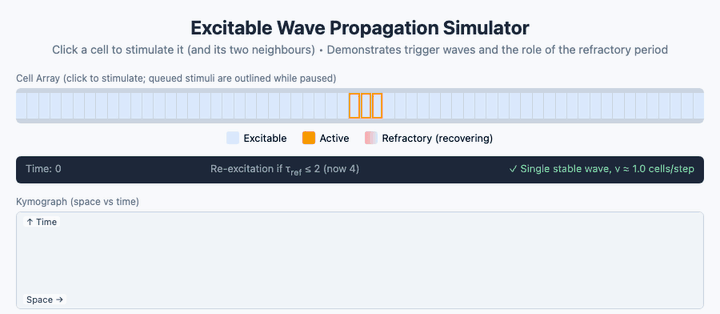

# Excitable Wave Propagation Simulator



*Default parameters, "Stimulate Centre": two trigger waves run outward at 1 cell/step, each followed by a refractory band. The kymograph (time runs upward) traces them as a V. For the GIF, the kymograph is shortened to 60 time steps (150 in the app).*

**▶ Live demo:** [macdobry.net/teaching/excitable-waves-demo/wave_simulator.html](https://macdobry.net/teaching/excitable-waves-demo/wave_simulator.html)

An interactive browser demo for teaching how **trigger waves** travel through an excitable medium: a line of cells that can fire, signal to their neighbours, and then need time to recover. The same principles underlie action potentials in nerves and heart muscle, Ca²⁺ waves, and cAMP waves in *Dictyostelium*.

With this demo, students can see:

- a local stimulus starting a wave that travels at **constant speed without losing amplitude**;
- the **refractory period** keeping the wave one-way, and what happens when it is too short;
- that a wave only propagates if the signal from a firing cell is strong enough to push its neighbour past **threshold**;
- two waves **annihilating** when they collide.

## Quick start

Try it online at the [live demo](https://macdobry.net/teaching/excitable-waves-demo/wave_simulator.html), or open `index.html` locally in any modern browser — no installation, server or internet connection needed.

To hand the demo out as a single file (e-mail, ILIAS/Moodle upload), run `./build.sh` and distribute `dist/wave_simulator.html`.

## How it works

### The cells

The medium is a line of 60 cells. Time advances in discrete steps (20 per second). Each cell is in one of three states:

| State | Colour | Meaning |
|---|---|---|
| **Excitable** | light blue | at rest; fires if its input exceeds the threshold θ |
| **Active** | orange | firing, for τ_pulse steps |
| **Refractory** | pink → blue | recovering, for τ_ref steps; cannot fire whatever its input |

A firing cell releases a **messenger**. Its level is 1 while the cell is active. After that it decays by a factor e^(−1/τ_sig) per step, so τ_sig is the messenger's lifetime.

### Coupling

Cell *i* receives input from all cells within the coupling range:

  input_i = Σ_j D · λ^|i−j| · messenger_j

Here D is the coupling strength and λ the spatial decay per cell of distance. An excitable cell fires when input_i > θ.

All cells are updated **simultaneously** from the previous state, so waves travel equally fast in both directions.

With the default **nearest-neighbour coupling** (range = 1), the rule is simple. A firing cell gives its neighbour an input of D·λ = 0.30 × 0.65 = **0.195**. That is above θ = 0.18, so the neighbour fires one step later, then its neighbour, and so on. The wave moves at 1 cell per step.

### Stimulating

Click a cell, or use the **Stimulate Left / Centre / Right** and **Both Ends** buttons. Each stimulus fires a block of 3 neighbouring cells at the next time step. A larger stimulus is needed with long-range coupling, where a single cell may be too weak to start a wave.

### What you see

- **Cell array** (top): the current state of every cell.
- **Kymograph**: a space–time plot. Each row is one time step, with the newest row at the top. A travelling wave appears as a slanted orange line followed by a pink refractory band. Its slope gives the wave speed.
- **Status bar**: classifies the current parameters by running hidden test waves:
  - ✓ single stable wave, with its speed;
  - ⚠ re-excitation (repeated waves);
  - ⚠ local re-firing (stimulated cells re-fire briefly, but no wave spreads);
  - ✗ stimulus too weak to start a wave, though a running wave would propagate;
  - ✗ no propagation at all.

  It also shows the largest τ_ref at which cells re-fire for the current settings ("Re-excitation if τ_ref ≤ k").

### Parameters

| Slider | Symbol | Default | Role |
|---|---|---|---|
| Pulse width | τ_pulse | 1 | steps a cell stays active |
| Refractory period | τ_ref | 4 | steps a cell needs to recover |
| Signal lifetime | τ_sig | 4 | lifetime of the messenger after firing stops |
| Coupling strength | D | 0.30 | strength of the signal to neighbours |
| Activation threshold | θ | 0.18 | input needed to fire |
| Coupling range | — | 1 | how many cells away a cell is heard |
| Spatial decay | λ | 0.65 | signal attenuation per cell of distance |

## Guided experiment

Press **Reset** before each part. **Pause** freezes the display if you want to discuss a pattern.

### 1. A trigger wave (default parameters)

Click **Stimulate Centre**.

- Two waves run outward at a constant 1 cell/step and disappear at the ends. In the kymograph they form a "V".
- Every cell fires **exactly once**. Behind each wave front is a refractory band, and the wave cannot turn back into it.
- The status bar shows *✓ Single stable wave, v ≈ 1.0 cells/step* and *Re-excitation if τ_ref ≤ 2 (now 4)*.

**Points to discuss:**
- The amplitude does not decay with distance: each cell regenerates the signal.
- The speed is set by the medium, not by the stimulus.

### 2. Lowering the refractory period: re-triggering

Lower **τ_ref** step by step, pressing Reset and **Stimulate Centre** each time.

- **τ_ref = 3:** still a single wave.
- **τ_ref = 2:** the stimulated cells recover while their neighbours' messenger is still above threshold, so they **fire again**. The stimulus site becomes a **pacemaker**, emitting a new pair of waves every 4 steps (τ_pulse + τ_ref + 1) until you press Reset. The kymograph fills with nested "V"s.
- **τ_ref = 1 or 0:** the waves follow each other even more closely (every 3 or 2 steps).

**Points to discuss:**
- Refractoriness is what makes the wave a single, one-way event.
- The switch is **not** at τ_ref = τ_sig. A cell re-fires if its neighbours' leftover messenger is still above θ when it recovers. τ_sig is a decay time (the messenger falls to 37 %), not the time the messenger stays above threshold. For a travelling wave, re-excitation needs τ_ref < τ_sig · ln(D·λ·(1+δ²)/θ), with δ = e^(−1/τ_sig). At the defaults that is about 0.55·τ_sig. The stimulus site, where 3 cells fired together, can re-fire at a τ_ref one step higher than this.
- **Variation:** set τ_ref = 4 and raise τ_sig to 8. A longer-lived signal also causes re-triggering, and the status bar now reports re-excitation up to τ_ref ≤ 5.

### 3. Lowering coupling: blocking propagation, then rescuing it with θ

Set τ_ref back to 4 (τ_sig = 4). Then lower **D**, pressing Reset and **Stimulate Centre** each time.

- **D = 0.28:** the wave still propagates (D·λ = 0.182 > θ = 0.18).
- **D = 0.27:** the stimulated cells fire, but **no wave starts**. Each neighbour now receives only D·λ = 0.1755, just below θ. The status bar reports *✗ No propagation*.
- **D = 0.25:** still blocked.

Now lower **θ**, keeping D = 0.25 (D·λ = 0.1625):

- **θ = 0.17:** still blocked.
- **θ = 0.16:** the wave **propagates again**.

**Points to discuss:**
- Propagation is all-or-none. It depends on whether the input a firing cell delivers (D·λ) exceeds the threshold θ, not on either number alone.
- Weaker coupling, as in reduced gap-junction conductance in heart tissue, can block conduction. A more excitable tissue (lower θ) can compensate.
- **Variation:** starting from the defaults, raise θ to 0.20. This blocks the wave too.
- **General formula.** A wave front either moves forward every step or dies, because once no new cell fires the inputs ahead only decay. In a wave moving 1 cell/step, the cell k places behind the front fired k − 1 steps ago. With coupling range R, the cell just ahead of the front therefore receives

  I = Σ_{k=1}^{R} D · λ^k · s(k−1),  where s(a) = 1 while a < τ_pulse and e^(−(a−τ_pulse+1)/τ_sig) afterwards,

  and the wave propagates if θ < I. If τ_pulse ≥ R, all R cells behind the front are still firing and this is a geometric sum: **θ < D·λ·(1 − λ^R)/(1 − λ)**. For R = 1 it is the rule D·λ > θ above. τ_ref plays no role.
- **Starting a wave** needs more: a click fires 3 cells, which give the next cell D·(λ + λ² + λ³) (for R ≥ 3). A click starts a wave if θ is below both this value and I.
- **Caveat:** with long range and a short pulse (τ_pulse < R), a faster wave (2 or more cells/step) can survive slightly above I. The input can never exceed D·λ·(1 − λ^R)/(1 − λ), so no wave propagates above that value.

## More experiments

These are also described on the page itself:

- **Wave collision:** click **Both Ends**. The two waves meet and annihilate, because each runs into the other's refractory band.
- **Starting vs. sustaining a wave:** set coupling range = 8, τ_pulse = 8, τ_ref = 15.
  - The wave is faster (2 cells/step at θ = 0.30).
  - At θ = 0.45 a click no longer starts a wave: the 3 clicked cells give the next cell only D·(λ + λ² + λ³) ≈ 0.40.
  - A wave started at θ = 0.30 keeps going when θ is raised to 0.45 while it travels, because its front is driven by the many active cells behind it: 8 firing cells give D·λ·(1 − λ^8)/(1 − λ) ≈ 0.54. Above that, even a running wave dies.

## Files

| File | Contents |
|---|---|
| `index.html` | page layout, controls and experiment descriptions |
| `styles.css` | styling |
| `model.js` | the model: cell update rule and the hidden test waves for the status bar (no page code) |
| `app.js` | animation loop, drawing, controls |
| `tests.js` | unit tests for the model |
| `build.sh` | builds the single-file `dist/wave_simulator.html` |
| `docs/propagating_wave.gif` | animation shown at the top of this README |
| `make_gif.sh` | regenerates that GIF (needs Google Chrome and Python with Pillow; ~2 min) |

## Tests

```
node --test tests.js
```

Requires Node ≥ 18; no other dependencies. The tests check:

- the cell rules: timing, messenger decay, threshold, refractoriness and simultaneous updating;
- the teaching claims: wave speed, annihilation, and every result quoted in the experiments text;
- the status-bar logic;
- the re-excitation and propagation-threshold formulas above;
- that the slider defaults in `index.html` match the model.

If you change a default or a model rule, run the tests and update the experiment text where they fail.
